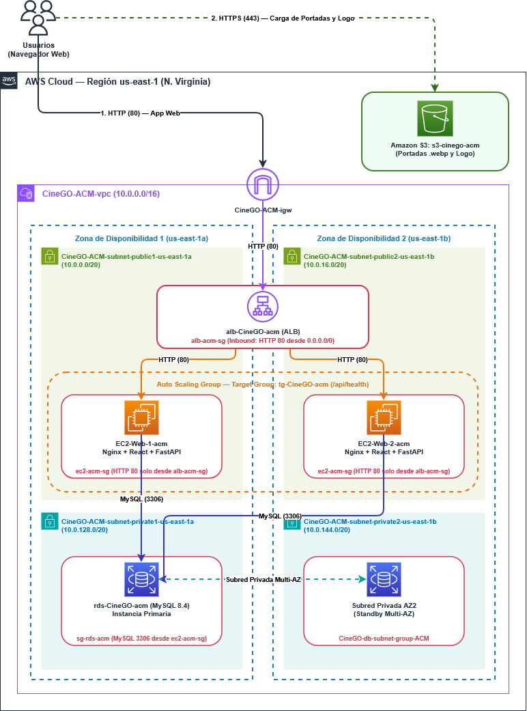

# Cartelera de Películas

Aplicación web desarrollada con **React + Vite + Tailwind CSS** (Frontend), **FastAPI** (Backend), **Amazon RDS MySQL** (Base de datos) y **Amazon S3** (Almacenamiento de portadas).

## 📁 Estructura del Proyecto

```text
cartelera-peliculas/
├── .gitignore               # Ignora .env, __pycache__/, node_modules/, dist/
├── readme.md                # Documentación, dependencias y pasos de despliegue
├── .env.example             # Plantilla de variables de conexión a RDS
├── draw.io.png              # Diagrama de arquitectura original de draw.io
├── draw.io-preview.svg      # Vista del diagrama con fondo blanco para el README
├── backend/
│   ├── main.py              # API con FastAPI cargando variables desde .env
│   └── requirements.txt     # Dependencias de Python
├── deploy/
│   ├── ec2-user-data.sh      # Instalación en EC2 con Nginx, React y FastAPI
│   ├── init_database.py     # Inicialización de RDS con bloqueo entre instancias
│   └── test_init_database.py # Pruebas de inicialización de la base de datos
├── frontend/
│   ├── vite.config.js       # Plugin de Tailwind CSS v4
│   └── src/
│       ├── styles.css       # Estilos de la aplicación y temas claro/oscuro
│       ├── main.jsx         # Punto de entrada de React
│       ├── App.jsx          # Cartelera, filtros, lista guardada y detalle en modal
│       ├── services/
│       │   ├── api.js       # Llamadas HTTP al backend
│       │   ├── formato.js   # Formato de duración de películas
│       │   └── validacionPelicula.js # Validación del formulario de películas
│       └── components/
│           ├── Navbar.jsx  # Navegación y cambio de tema
│           ├── PeliculaCard.jsx # Tarjeta de película y acceso al detalle
│           ├── AgregarPelicula.jsx # Formulario para crear una película en RDS
│           ├── Modal.jsx   # Ventana modal reutilizable
│           └── Icon.jsx    # Iconos de la interfaz
└── sql/
    └── schema.sql           # Script de creación de tablas Generos y Peliculas + datos semilla
```

## Dependencias del Backend (Python)
```bash
pip install fastapi uvicorn pymysql pydantic python-dotenv
```

## Dependencias del Frontend (React y Utilidades)
```bash
npm install axios react-router-dom
npm install -D tailwindcss @tailwindcss/vite
```

## Despliegue Básico
1. **Base de datos:** Ejecutar `sql/schema.sql` en la instancia de Amazon RDS MySQL.
2. **Backend:** Copiar `.env.example` a `backend/.env`, completar credenciales de RDS y levantar desde `backend/` con:
   ```bash
   uvicorn main:app --host 0.0.0.0 --port 8000
   ```
3. **Frontend:** Compilar los archivos estáticos dentro de `frontend/`:
   ```bash
   npm run build
   ```

Para desplegar en EC2, configurar `deploy/ec2-user-data.sh` y usarlo como User Data de la instancia. El script instala las dependencias, inicializa RDS mediante `deploy/init_database.py`, compila el frontend y configura Nginx y el servicio de FastAPI.

## Diagrama de arquitectura

El diagrama se muestra sobre fondo blanco para mantener el contraste y la legibilidad tanto en tema claro como oscuro. Haz clic para abrir el PNG original de draw.io.


